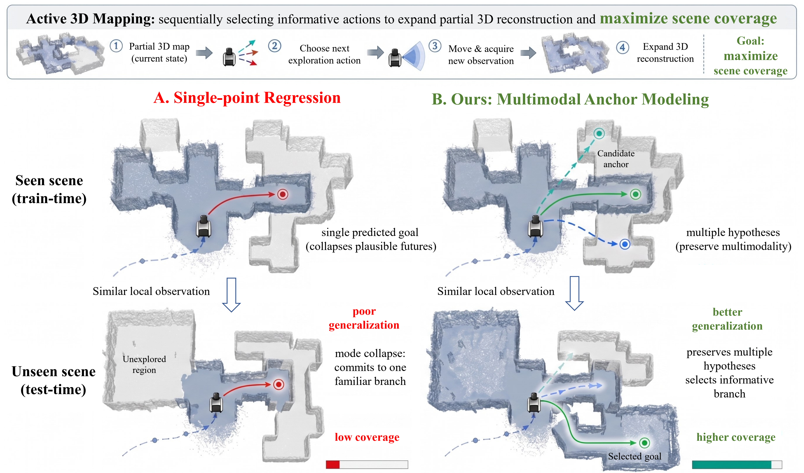
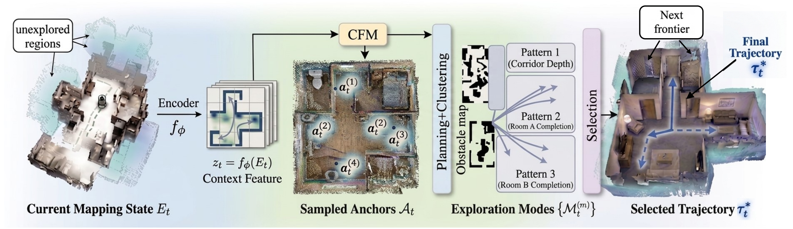

## Motivation

Active 3D mapping requires an agent to explore an unknown scene and expand its reconstruction under a limited sensing budget. Under **partial observability**, similar local observations can admit several plausible long-horizon exploration directions. Predicting a single goal collapses these alternatives into one decision, which can become brittle when the unseen scene continues differently from the training scenes. We address this problem by learning a **conditional multimodal distribution over exploration anchors**, preserving alternative hypotheses before planning and selecting an executable trajectory.

  

<em>Motivation: preserve multiple plausible exploration hypotheses to improve generalization and scene coverage in unseen environments.</em>

## Framework

  

Our framework encodes the projected mapping state and trajectory history, and consists of three main components:

- **Conditional Flow Matching (CFM):** Learns a context-conditioned distribution over compact position-and-orientation anchors, generating multiple plausible long-horizon exploration hypotheses.
- **Obstacle-Aware Planning and Mode Construction:** Converts sampled anchors into executable candidate paths with an A*-based planner, then groups geometrically similar paths into exploration modes to reduce redundancy.
- **Hierarchical Selection:** First selects the most promising exploration mode, then reranks paths within that mode to produce the trajectory for execution.
